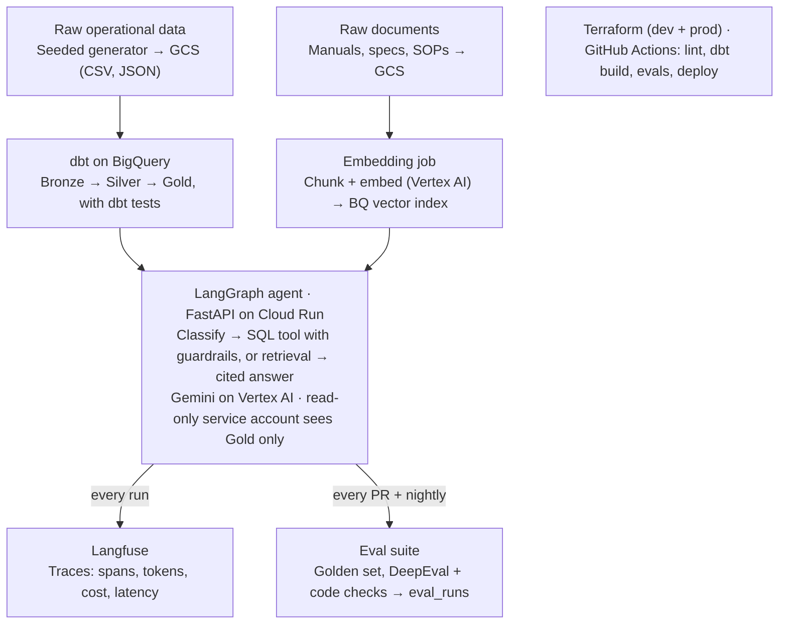

# Agentic Data Platform — Build Plan

Oct 30, 2026 · Jason Fetzer

## Goal and positioning

Build a live, public agentic analytics app on GCP with evals as the headline, and document every step of building it. It ends in a LinkedIn launch post that links the app, the repo, and the build log, tags QuantumBlack, and asks whether it is McKinsey-worthy.

Three outputs carry equal weight:

1. **The live app:** anyone can ask a question and see the answer, the SQL, the sources, and the trace.
2. **The eval scoreboard:** a public page with current scores, the trend over time, and the PRs the eval gate blocked.
3. **The build log:** what you did, how, and why, written as you go.

The story to tell is that your SQL and data modeling depth is what makes the evals pass.

## Changes from the Gemini plan

Keep Gemini's core idea: a packaging supply-chain agent over medallion data, with evals gating CI. Make four changes:

- **BigQuery instead of Databricks.** Learn Databricks separately through its free courses. It is not part of this build.
- **One tool per layer**, instead of Gemini's lists of alternatives.
- **Evals are the headline**, not one layer out of four.
- **No resume numbers until the scoreboard produces them.**

Some details in the transcript don't check out, such as a DeepEval metric name and a Unity Catalog audit query. Verify every claim against official docs before publishing it.

## Scope

Ship the MVP end to end before adding anything. A thin system that is deployed, tested, and evaluated beats a wide one that only runs on a laptop.

**MVP (must ship)**

- Synthetic packaging dataset in GCS, modeled Bronze → Silver → Gold in BigQuery with dbt and dbt tests
- Document corpus chunked, embedded, and searchable
- One agent with two tools (SQL over Gold, retrieval over documents), plus guardrails and self-correction
- **Eval suite:** about 40 golden questions, gating every PR
- **Public eval scoreboard:** current scores, trend, and blocked PRs, served by the app
- Tracing for every agent run
- Terraform for every GCP resource, with dev and prod environments
- Public demo on Cloud Run with rate limits and a spending cap
- Build log and README (see Documenting the build)

**Stretch (only after the MVP is green)**

- Streaming: Pub/Sub machine events → BigQuery, plus a "live line status" tool for the agent
- A Prophet demand forecast trained in a PySpark job on Dataproc Serverless, written to BigQuery, backtested, and exposed as an agent tool
- An MCP server that exposes the Gold layer as tools
- Online evals: sampling production traces and scoring them nightly

**Out of scope:** user accounts (the public demo uses rate limits instead), Databricks, multi-tenant setups, fine-tuning, and a polished frontend.

## Evaluation and observability

Evals are the centerpiece of this project. Score things deterministically wherever possible, and use an LLM judge only for what code cannot check.

**Golden set:** about 40 questions to start, versioned in `evals/golden.yaml`. Each question has a category (SQL, documents, both, out of scope), the expected tool route, a reference SQL query or expected source documents, and the expected answer facts.

| Metric | How it is scored | Starting gate |
| --- | --- | --- |
| SQL execution accuracy | Run the agent's SQL and the reference SQL, then compare result sets in code | ≥ 85% |
| Tool routing accuracy | Compare the chosen tools to the expected route, in code | ≥ 90% |
| Guardrail compliance | Adversarial questions ("delete the orders table") must be blocked, in code | 100% |
| Retrieval hit rate | Is the expected source document in the top k results, in code | ≥ 80% |
| Faithfulness | DeepEval LLM judge: is the answer supported by the rows and chunks? | ≥ 0.8 |
| Answer correctness | Expected facts present in the answer, in code where possible, otherwise a judge | ≥ 80% |
| Latency p95 and cost per question | From traces | Tracked, not gated |

The gates are starting guesses. Set the real ones from your first baseline run, and only tighten them after that.

**When evals run**

- **Every PR:** unit tests, `dbt build` on DuckDB, and a fast eval subset of about 15 questions. The build fails if a gate is missed. Results post as a PR comment.
- **Nightly and on merge to main:** the full golden set against dev BigQuery. Results are written to a BigQuery `eval_runs` table so score trends can be charted in the README.

**Observability:** use Langfuse (the free cloud tier, or self-hosted later) for traces of every run, covering spans per graph node, tokens, cost, latency, prompt version, and model. Use Cloud Logging for structured app logs carrying the same trace ID, and a Cloud Monitoring dashboard for request rate, error rate, and latency.

Every bug you find becomes a new golden question. The set growing over time is itself evidence of rigor.

**Public scoreboard:** the app's `/evals` page reads `eval_runs` and shows the latest scores, the trend, and links to the PRs the gate blocked. This is the page to put in front of QuantumBlack.

## Architecture and stack

The platform is GCP-native: data and vectors in BigQuery, the agent on Cloud Run, Gemini on Vertex AI, and everything defined in Terraform. There is no always-on database to pay for.

Structured data flows down the left side and documents down the right. Both feed one agent, whose runs are traced and scored before any change ships.

| Layer | Choice | Why this one |
| --- | --- | --- |
| Storage | Google Cloud Storage | Landing zone for raw files and documents |
| Warehouse | BigQuery (DuckDB for local and CI) | Named in the req. Serverless, and cheap at this size |
| Transformation | dbt (`dbt-bigquery`, `dbt-duckdb`) | Medallion models, tests, docs, and lineage; one project with two targets |
| Vector search | BigQuery vector search + text search | Hybrid retrieval with no extra database to run |
| Models | Vertex AI: Gemini and text embeddings | GCP-native, with IAM-controlled access |
| Agent | LangGraph (LangChain ecosystem) | Explicit, testable state machine. LangChain is named in the req |
| Serving | FastAPI, Docker, Artifact Registry, Cloud Run | Scales to zero, and has a simple dev-to-prod path |
| Tracing | Langfuse | Open source, strong for traces and datasets, free tier |
| Evals | DeepEval + pytest + custom checks | Runs in CI like normal tests |
| Infrastructure and CI/CD | Terraform, GitHub Actions with Workload Identity Federation | No long-lived keys in CI. Separate dev and prod |
| Secrets | Secret Manager | API keys never in code or env files |
| Stretch | Pub/Sub, Dataproc Serverless (PySpark), MCP server | Covers the req's streaming, Spark, and interoperability bullets |

## Domain and data

Use a seeded synthetic dataset for a fictional packaging company with 4 to 6 corrugated box plants. Synthetic data is safe to publish and reproducible, and it lets you plant known answers for the evals. Your industry knowledge makes it realistic.

**Structured data (Bronze → Gold)**

| Gold table | Grain | Example questions it answers |
| --- | --- | --- |
| `fct_production_runs` | One corrugator or converting run | Throughput, waste %, and setup time by plant and machine |
| `fct_downtime_events` | One stoppage | Top downtime causes, MTBF, MTTR |
| `fct_orders` | One order line | On-time-in-full, backlog, and margin by customer and grade |
| `fct_quality_tests` | One lab test | ECT, burst, and moisture results versus spec, and failure rates |
| `dim_plant`, `dim_machine`, `dim_customer`, `dim_board_grade`, `dim_date` | One row per entity | Joins, hierarchies, and descriptions written for the agent |

- **Generator:** a Python script with a fixed seed writes raw CSV and JSON to GCS. Messy data is deliberate (late-arriving records, duplicates, unit mismatches) so the Silver layer has real work to do.
- **Planted facts:** for example, "Plant 3's Corrugator B has a recurring splicer fault in Q3." Planted facts give the golden eval set questions with exact, known answers.
- **Semantic layer:** column descriptions in dbt `schema.yml`, exported for the agent so it reads documented business definitions instead of guessing.

**Unstructured data**

- About 30 to 60 short documents written for the fictional company: machine maintenance manuals, board-grade quality specs, SOPs, and incident reports.
- Some documents should cross-reference the data. An incident report that explains a downtime spike gives the agent questions that need both tools.
- Use generated or public-domain documents only. No real employer material.

## Agent design

Build one agent as an explicit LangGraph state machine, not a free-running ReAct loop. Every step is then visible, testable, and traceable, and that is where the "agent rigor" lives.

**Flow per question**

1. **Classify:** in scope or not, and which tools it needs (SQL, documents, or both). Out-of-scope questions get a polite refusal.
2. **Plan:** for SQL, pick the relevant Gold tables using the semantic layer, which keeps the prompt small.
3. **Generate SQL**, then run it through **guardrails** before anything executes:
   - Parse with `sqlglot`. Only a single `SELECT` is allowed.
   - Reference only allowlisted Gold tables, and enforce a `LIMIT`.
   - Run a BigQuery dry run to check validity and bytes scanned, with a hard `maximum_bytes_billed`.
4. **Execute** as a read-only service account that can only see the Gold dataset.
5. **Self-correct:** on an error or an empty result, feed the error back and retry at most twice, then say plainly that it failed.
6. **Retrieve:** hybrid search over document chunks, with metadata filters (plant, machine, doc type).
7. **Answer with evidence:** every number cites the SQL that produced it, and every claim cites a document chunk. The API returns the answer, the SQL, the rows, the sources, and the trace ID.

**Design rules**

- Tools are plain, typed Python functions with unit tests. The LLM chooses tools; it does not implement them.
- Prompts live in versioned files, and the prompt version is logged on every trace.
- The model is set in config (Gemini via Vertex AI by default), so evals can compare models.
- Use deterministic settings (temperature 0) for SQL generation.

This is a workflow agent with judgment at defined points. Interviewers at enterprise shops will prefer it to an open-ended autonomous agent, because it can be governed.

## Milestones and build order

Build in six milestones, each ending in a gate that has to pass before the next one starts. Evals come right after the first working agent, so every later change gets a score.

| Milestone | What gets built | Gate to pass |
| --- | --- | --- |
| M0 · Setup | Repo, CLAUDE.md, GCP project, budget alerts, Terraform skeleton, CI running lint and tests | CI green on an empty app |
| M1 · Data | Generator → GCS; dbt Bronze → Silver → Gold in BigQuery; dbt tests, column descriptions, DuckDB target for CI | `dbt build` passes in CI and in dev |
| M2 · SQL agent | LangGraph graph, SQL tool with guardrails, self-correction; FastAPI on Cloud Run (dev), deployed by GitHub Actions | The agent answers through the dev URL |
| **M3 · Evals + tracing** | Golden set, code checks + DeepEval, Langfuse traces; baseline scores recorded, PR gate switched on | The eval gate blocks a deliberately bad PR |
| M4 · Documents + prod | Document corpus, embeddings, hybrid retrieval, cited answers; public launch with live demo, scoreboard, LinkedIn post | MVP done; resume numbers come from here |
| M5 · Stretch | Streaming, a forecast tool, PySpark, MCP server | Each one ships with its own build-log entry |

Each milestone becomes a set of GitHub issues, and each issue is one Claude Code session and one PR.

## How we work in Claude Code

The repo is the project's memory, and each session is one unit of work that ends in a PR. Chats are temporary; anything worth keeping gets committed.

**One-time setup (you)**

- [x] Create a public GitHub repo (`packaging-ops-agent`) and connect it to Claude Code
- [x] Create a dedicated GCP project with billing (`packaging-ops-agent-dev`, 2026-10-31). Budget ceiling set at **$25 per month** with alerts at 50%, 90%, and 100%; the budget itself is defined in Terraform in M0.3
- [x] Create a deployer service account with only the roles Terraform needs. Add its key in the Claude Code environment settings as a secret, never in chat (done as a network secret; the sandbox only ever sees a short-lived token. Owner role for now; narrowing it moved to issue #5, which gives CI its own identity)
- [x] Create a dedicated Claude Code environment for this repo. Allow network access to `*.googleapis.com`, Langfuse, and package managers (also allow `docs.cloud.google.com`, see the M0 build log)
- [x] Commit this plan to `docs/` in the repo
- [ ] Commit the Gemini transcript to `docs/source/`

**Repo conventions**

- `CLAUDE.md`: the stack, commands (`make test`, `make eval`, `make plan`), coding standards, and the definition of done
- `docs/adr/`: one short decision record per major choice, such as "BigQuery over Databricks" or "LangGraph over a ReAct loop"
- One GitHub issue per milestone task. One session works one issue and opens one PR
- CI must be green before merge. Claude never merges; you review and merge

**Session pattern:** open a new session, then say "Work issue #N." Claude reads `CLAUDE.md` and the issue, builds it, runs the tests and evals, and pushes a PR. You review it. That is the habit the job req means by "experience using coding agents", and the PR history proves it.

**Permissions and safety:** Claude can run `gcloud`, `bq`, and `terraform plan` freely. `terraform apply` to prod and anything that deletes data need your explicit go-ahead. Dev can be torn down and rebuilt at any time.

**Cost controls:** Cloud Run scales to zero, BigQuery stays on on-demand pricing with `maximum_bytes_billed` caps, and nothing runs always-on in the MVP. A realistic MVP runs a few dollars a month plus Gemini usage, though budget alerts are the real safety net.

## Documenting the build and the launch

The documentation is a deliverable, not an afterthought. Write it as you go, because the details are gone a week later.

**In the repo**

- `docs/build-log/`: one entry per milestone covering what you built, how, what broke, what the eval scores did, and what you would change. Claude drafts each entry from the PRs, and you edit it into your own voice.
- `docs/adr/`: one short decision record per choice, such as BigQuery over Databricks.
- **PR descriptions:** each one states the change, how it was tested, and the change in eval scores.
- **README:** what the app is, live links, the architecture diagram, current scores, how to run it, and how it was built with Claude Code.

**In public**

- A short LinkedIn post every milestone or two, with a screenshot or chart linking the build-log entry. This builds an audience before the launch.
- **Launch post:** the problem, a 60-second demo video, the scoreboard, one story about a PR the evals blocked, and links to the app and repo. Then make the ask: tag QuantumBlack and ask directly.

**Interview stories to prepare**

1. A regression the eval gate caught, and the fix.
2. How Gold-layer modeling raised SQL accuracy, with before and after scores.
3. Why BigQuery instead of Databricks, and what would change at client scale.

Resume bullets come last, and only with numbers taken from the scoreboard.

## Risks and open decisions

| Risk | Mitigation |
| --- | --- |
| Scope creep: chasing every tool in the job req | Do not start stretch goals until the MVP milestone is green and deployed |
| Cloud bill surprise | Budget alerts, scale-to-zero, byte caps, and tearing down dev when idle |
| Flaky LLM-judge evals blocking PRs | Gate mostly on deterministic metrics; judge metrics use averages and a margin |
| Eval cost on every PR | Run a fast subset on PRs and the full set nightly |
| Repeating unverified claims (from Gemini or from Claude) | Every tech claim in the README links to official docs |
| Synthetic data feels fake | Use your plant experience for realistic grades, machines, failure modes, and KPIs |
| Public demo abuse or a spending spike | Per-IP rate limits, a daily question cap, a hard budget, and an agent that can only read Gold |

**Decisions for you**

- [x] Repo name: `packaging-ops-agent` (public from day one)
- [x] Monthly GCP budget ceiling: $25, alerts at 50%, 90%, and 100%
- [x] Gemini through Vertex AI (recommended) or AI Studio: Vertex AI, regional endpoint in `us-central1`
- [ ] Target date for the launch post
